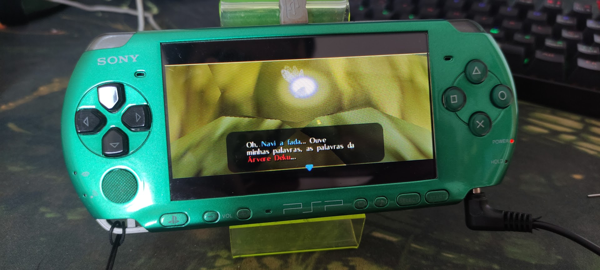
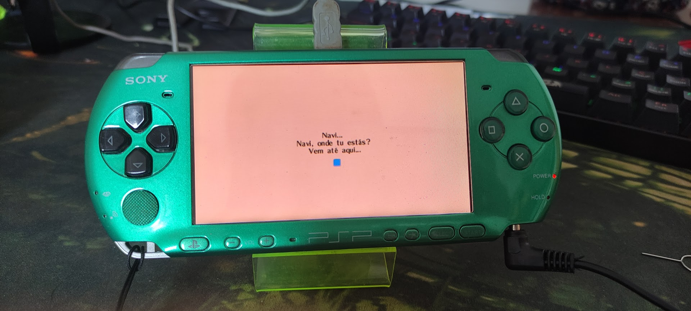
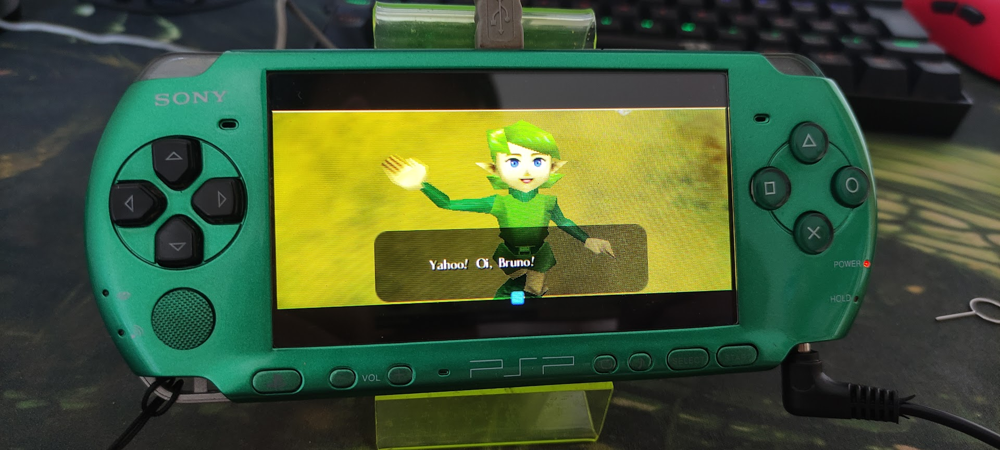
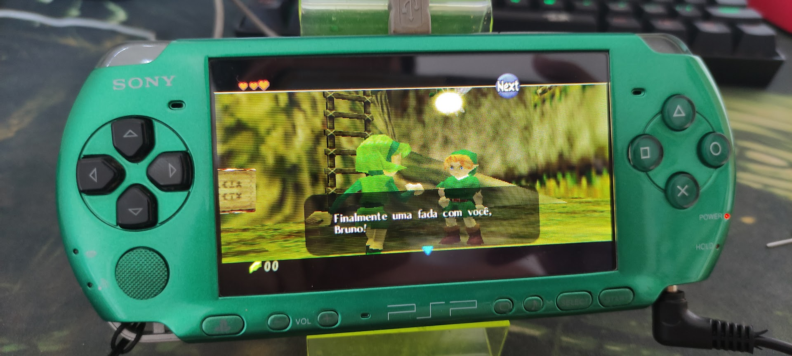

# Ocarina of Time PSP em português brasileiro


Adaptação dos diálogos da tradução brasileira de **Ocarina of Time Redux T1.8** para o port nativo de PSP do **z2442**, versão **1.0**. O patch inclui a fonte usada na tradução e importa 2.115 entradas do banco de mensagens. Os diálogos iniciais foram conferidos em um PSP real. Menus, botões e textos em imagens podem continuar em inglês.

## Como instalar pelo Windows

Baixe o **[Ocarina-PSP-PTBR.exe](Ocarina-PSP-PTBR.exe?raw=true)** para Windows 64 bits. O executável inclui o ambiente Python.

1. Instale o [port de PSP 1.0](https://github.com/z2442/oot-PSP/releases/tag/1.0) com a ROM original como `data/baserom.z64`. Inicie o jogo em inglês uma vez para gerar `data/segments/oot_psp_assets.bin` e feche o jogo.
2. Abra o executável e selecione a ROM **USA NTSC 1.0** e a ROM **Redux T1.8 em PT-BR** da campanha normal, ambas em formato `.z64`.
3. Selecione a pasta do port que contém o `EBOOT.PBP` e a pasta onde deseja salvar o resultado. Clique em **Gerar arquivos PT-BR**.
4. Faça backup dos arquivos originais no PSP. Copie `EBOOT.PBP` e `data/segments/oot_psp_assets.bin` da pasta `saida-ptbr` para os mesmos caminhos na pasta do jogo.

## Alternativa pelo terminal

Você vai precisar de **Python 3**, do [port de PSP 1.0](https://github.com/z2442/oot-PSP/releases/tag/1.0), da ROM de N64 **USA NTSC 1.0 em formato big-endian** e da ROM **Redux T1.8 em PT-BR** da campanha normal. O patcher reconhece as duas ROMs pelo MD5. A edição Master Quest usa outro arquivo.

1. Instale o port, coloque a ROM USA NTSC 1.0 como `data/baserom.z64` e inicie o jogo em inglês uma vez. Aguarde o port criar `data/segments/oot_psp_assets.bin` e feche o jogo.
2. Baixe e extraia este repositório pelo botão **Code → Download ZIP**. Crie uma subpasta chamada `roms` ao lado de `aplicar_ptbr.py` e coloque as duas ROMs `.z64` nela.
3. Copie a pasta do jogo instalada no PSP para o computador, ao lado do script, e nomeie a cópia como `OOTPSP`. Ela deve conter `EBOOT.PBP` e `data/segments/oot_psp_assets.bin`.
4. Abra o terminal na pasta do script e rode:

   ```powershell
   python aplicar_ptbr.py OOTPSP
   ```

5. Guarde uma cópia do `EBOOT.PBP` e do `data/segments/oot_psp_assets.bin` originais. Copie os dois arquivos de `saida-ptbr` para os mesmos caminhos na pasta do jogo no PSP e inicie o port normalmente.

O repositório disponibiliza o patcher e as fotos. A ROM original continua em `data/baserom.z64`, e o script gera os dois arquivos modificados localmente. Para voltar ao inglês, restaure os dois arquivos do backup. Para gerar a saída novamente, renomeie a pasta `saida-ptbr` antes de repetir o comando.

| ROM esperada | MD5 |
| --- | --- |
| USA NTSC 1.0 | `5bd1fe107bf8106b2ab6650abecd54d6` |
| Redux T1.8 PT-BR (campanha normal) | `49183ac38c714be6dCDD968db436b860` |

## Fotos no PSP



| Introdução | Saria | Floresta Kokiri |
| --- | --- | --- |
|  |  |  |

## Créditos

- **Tradução original para PT-BR** por [Hyllian](https://romsportugues.com/tradutor/hyllian/) e [Odin](https://romsportugues.com/tradutor/odin/).
- **Adaptação para PSP** por [Bruno Ferreira](https://github.com/bruninho182). O trabalho consistiu em reaproveitar a tradução pronta da Redux T1.8 e adaptá-la ao port de PSP, que usa a ROM USA NTSC 1.0 como base.
- **Port nativo para PSP** por [z2442 e colaboradores](https://github.com/z2442/oot-PSP).
- **Referência para o formato dos arquivos do port** no [patcher italiano de noname8723](https://github.com/noname8723/oot-psp-italian), baseado no [patcher espanhol de Unbekantte](https://github.com/Unbekantte/oot-psp-spanish-patcher).

